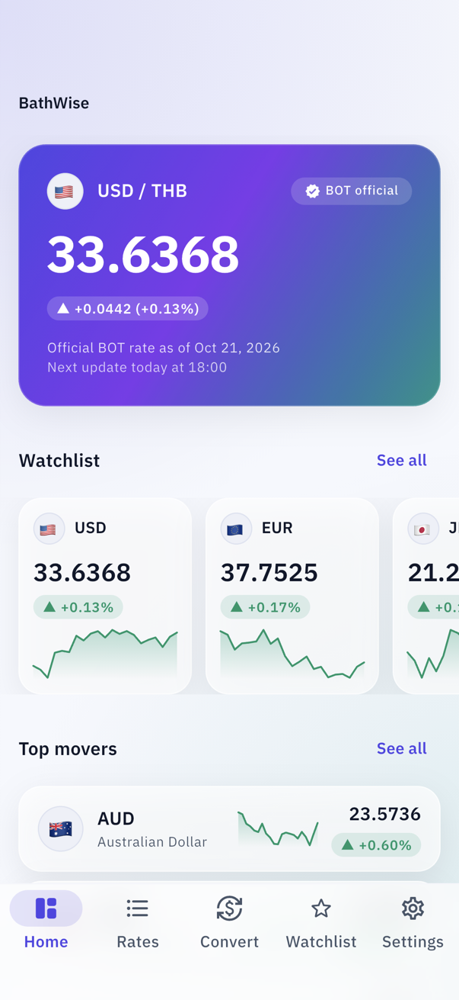
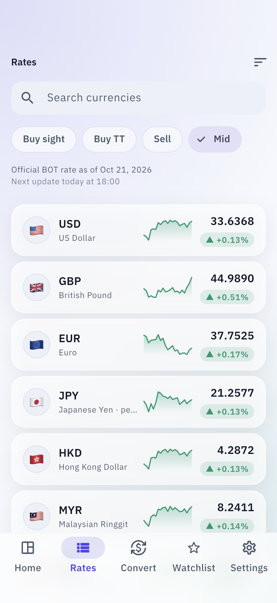
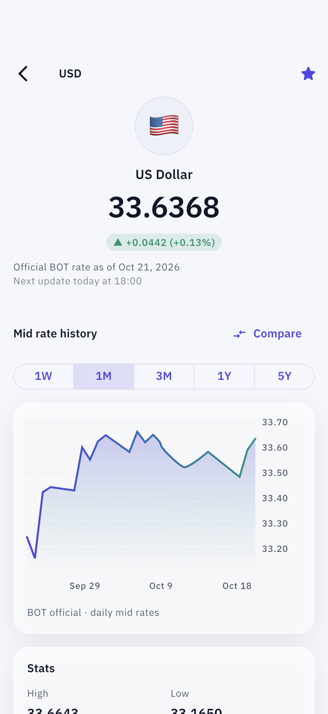
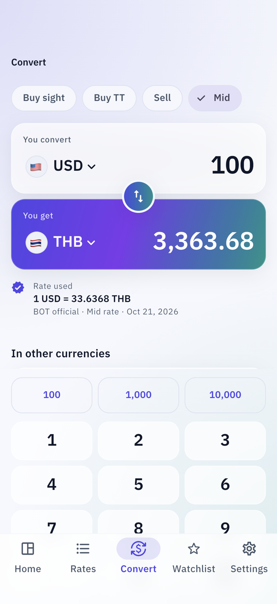
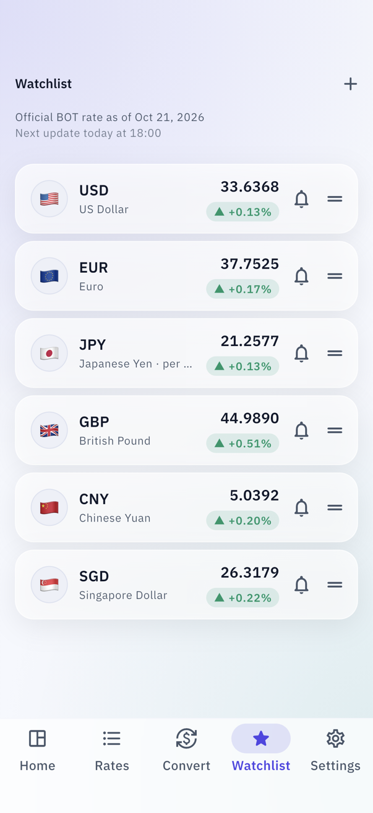
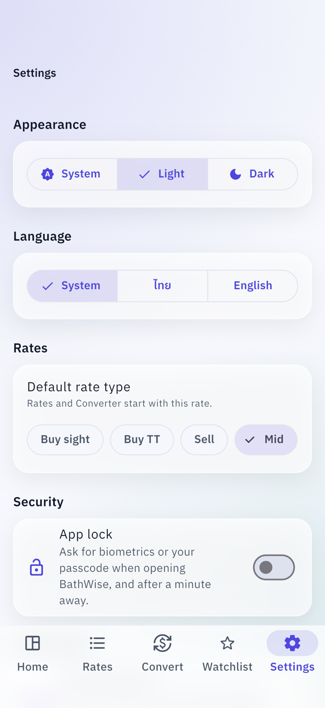
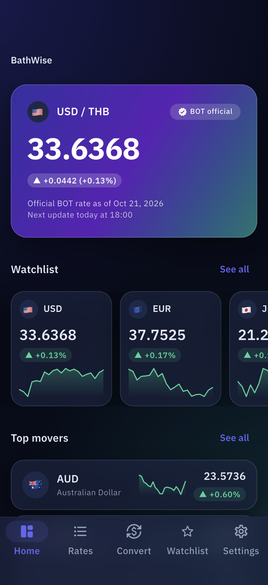
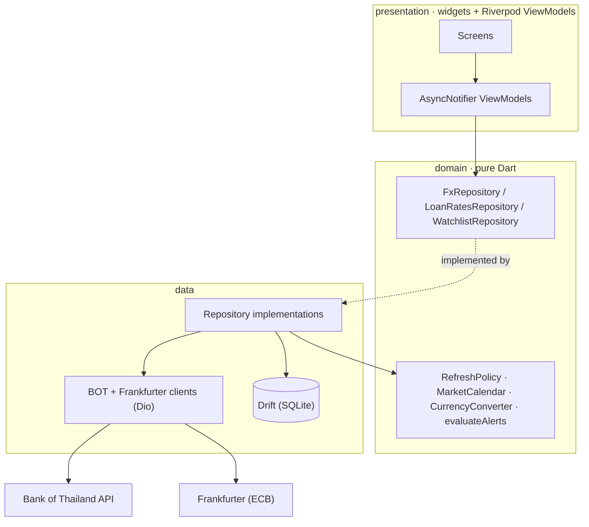
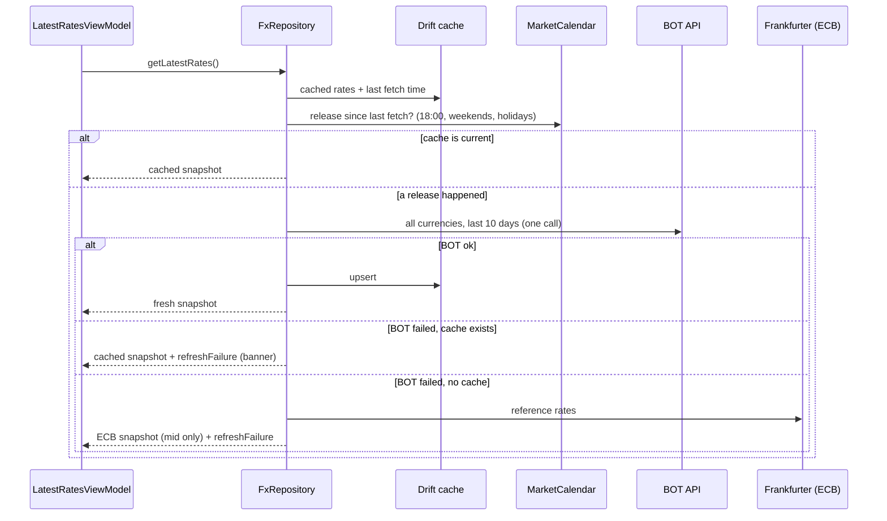

# BathWise

Thai Baht exchange rates from the Bank of Thailand, in a fintech-style
Flutter app: live official rates, a converter, history charts, a watchlist
with background rate alerts, and commercial bank loan rates. Thai and
English, light and dark.

> The name is spelled *Bath*Wise on purpose.

| Home | Rates | Currency detail | Converter |
| --- | --- | --- | --- |
|  |  |  |  |

| Watchlist | Settings | Dark theme |
| --- | --- | --- |
|  |  |  |

Screenshots come from the real app with live data, captured by
`integration_test/screenshots_test.dart` (see [Screenshots](#screenshots)).

## Features

- **Official rates.** BOT daily averages for 19 currencies: buying sight,
  buying transfer, selling and mid, with daily change and sparklines.
  Every rate shows its source (BOT official or ECB reference).
- **Honest freshness.** Explains missing data ("Bank holiday (Chulalongkorn
  Day) — showing rates as of …"), shows the next expected update, and
  marks cached or fallback data.
- **Converter.** Custom keypad, quick amounts, animated swap, any pair
  (THB, or cross rates through ECB), and the exact rate used.
- **History.** 1W–5Y charts with crosshair, high/low/average/volatility,
  and a compare mode that overlays two currencies as % change.
- **Watchlist and alerts.** Reorder, swipe to remove with undo, and
  one-shot alerts ("tell me when USD selling rises to 34.00") checked in
  the background with at most one BOT call per run.
- **Loan rates.** MOR/MLR/MRR per bank, sortable and filterable by bank
  type, with BOT's market average.
- **Settings.** Theme, language (TH/EN), default rate type and a
  biometric app lock.
- **Built for everyone.** Screen reader labels throughout, tested at 200%
  text, two-pane layout on tablets.

## Getting started

1. Get a Bank of Thailand API token at https://portal.api.bot.or.th and
   subscribe it to the Exchange Rates, Loan Rates and Financial
   Institutions' Holidays APIs.
2. Create `.env` from the template and add your token (never commit it):

   ```sh
   cp .env.example .env
   ```

3. Install dependencies and generate code:

   ```sh
   flutter pub get
   dart run build_runner build -d
   ```

4. Run `flutter test`, then `flutter run`.

Requires Flutter 3.47 (Dart 3.13). The token is compiled in by
[envied](https://pub.dev/packages/envied) with obfuscation; see
[Trade-offs](#trade-offs) for what that does and doesn't protect.

## Architecture

Feature-first Clean Architecture with MVVM. Each feature has `domain`
(entities, repository interfaces, pure logic), `data` (DTOs, API clients,
Drift, repository implementations) and `presentation` (Riverpod
ViewModels and widgets). `core` holds what features share and never
imports a feature.



```
lib/
  core/        database, env, error (Result + Failure), l10n, money,
               network (Dio + interceptors), router, theme, time, widgets
  features/
    dashboard/       hero card, watchlist carousel, top movers
    rates/           FxRepository, rate list, currency detail
    converter/       keypad, conversion math
    chart/           history chart, stats, compare
    watchlist/       watchlist, rate alerts, background worker
    loan_rates/      per-bank and average loan rates
    market_calendar/ BOT holidays, release times, market status
    settings/        settings, app lock
```

**Stack:** Riverpod 3 (code generation), go_router (StatefulShellRoute,
5 tabs), Dio, Drift, freezed + json_serializable, `decimal` for all money
math, intl, fl_chart, flutter_animate, workmanager,
flutter_local_notifications, local_auth, shared_preferences.

**Errors.** Repositories return `Result<T>` (`Ok` / `Err`) with a sealed
`Failure` (`Network`, `Unauthorized`, `RateLimit`, `NoData`, …). Raw
exceptions never leave the data layer; the UI switches on the failure
type for its message and icon.

## Data flow

BOT publishes exchange rates on business days at 18:00 Bangkok time (loan
rates at 14:00). The app asks BOT only when a release has happened since
the last fetch, so normal use costs a handful of calls a day against the
200 calls/hour quota.



- **Cache rules.** Daily rates refetch only after the latest 18:00
  release on a business day; if that day's data is still missing (BOT is
  late, or a holiday we didn't know about) it retries at most every 30
  minutes. Loan rates follow 14:00. Holidays are cached per year.
  Pull-to-refresh skips the release check but is throttled to once a
  minute.
- **Network.** Interceptors in order: auth (BOT only) → logging with the
  token redacted → retry (timeouts and 502/503/504 only, never 4xx) →
  error mapping. Riverpod's automatic retry is off for BOT-backed
  providers so a 403 can't turn into a burst of calls. Identical requests
  in flight are deduplicated.
- **Rate alerts.** Workmanager runs a check about hourly while any alert
  is active. The worker's BOT client has a hard budget of one request, no
  retries, and reads holidays from cache only, so a run costs at most one
  BOT call, usually none. The app also checks alerts whenever it loads new
  rates. Only official BOT data can trigger an alert.

## Testing

```sh
flutter test                   # everything (264 tests)
flutter test --tags golden     # golden tests only
```

- **Parsing** against real responses captured by
  `tool/fetch_api_samples.dart` into `docs/api-samples/`, and spec-shaped
  fixtures where the token has no access yet.
- **Repositories:** cache rules, BOT → cache → ECB fallback, throttling,
  deduplication; the watchlist repository on an in-memory database.
- **Release-time logic:** 18:00 cut-off, weekends, holidays, late releases.
- **Converter math, chart statistics, alert evaluation, ViewModels.**
- **Background worker:** proves one BOT call per run, including when BOT
  fails.
- **Widget tests** for every screen, the app lock and language switching;
  every tab at 200% text on a small phone.
- **Goldens** for the hero card in light and dark.

## CI

`.github/workflows/ci.yml` runs on every push and pull request: creates
`.env` from the `BOT_API_TOKEN` repository secret (a placeholder when the
secret isn't available), generates code, then checks formatting, analyzes,
tests, and builds a release APK uploaded as an artifact.

## Screenshots

```sh
flutter drive -d <iPhone simulator> \
  --driver=test_driver/screenshots_driver.dart \
  --target=integration_test/screenshots_test.dart
```

Drives the real app through every tab and saves PNGs to
`docs/screenshots/`.

## Trade-offs

- **Token in the app.** BOT's API needs a token and has no per-user auth,
  so it ships in the binary. envied's obfuscation stops casual extraction,
  not a determined one. A production app would put a small proxy in front
  of BOT that holds the token, caches releases for all users and enforces
  the quota. For the same reason, a CI APK built with the real secret
  should stay private.
- **No backend means the device does the scheduling.** Alerts depend on
  Workmanager: about hourly on Android, but iOS decides when background
  refresh runs and may run it rarely. A server watching BOT and sending
  push notifications would be exact.
- **Release-time cache instead of a TTL.** BOT data changes once a
  business day, so a TTL would either waste calls or show stale rates
  after 18:00. The calendar-based policy is more code (and tests) but
  fetches exactly when there is something new.
- **Drift for data, shared_preferences for settings.** Rates, history,
  loans, holidays and the watchlist need queries, ranges and transactions.
  Settings are four values that must be readable before the first frame.
- **`decimal` everywhere.** Exchange math on doubles drifts; Decimal keeps
  conversions exact. Charts convert to double only for drawing.
- **ECB as fallback, not as a source.** ECB reference rates are mid only
  and a different fixing, so they're always labelled, never mixed into
  BOT data, and never trigger alerts.
- **Goldens across platforms.** Goldens are generated on macOS; Linux CI
  renders text with slightly different anti-aliasing, so the comparator
  accepts up to 1% pixel difference. Emoji flags render as boxes in tests
  (no emoji font).

## Known limitations

- **Loan rates and holidays without access.** As of October 2026 the
  development token gets `403` from the LoanRate and Holidays APIs. The
  Loan Rates screen and holiday handling are built and tested against
  fixtures shaped exactly like the API spec (`test/fixtures/`); without
  holidays the calendar falls back to weekends only.
- **No GIF yet.** The screenshots are stills.

## Data sources

- Bank of Thailand API: exchange rates, loan interest rates, financial
  institutions' holidays.
- [Frankfurter](https://frankfurter.dev): European Central Bank
  reference rates, used as fallback and for cross rates.

Rates are for information only and may differ from what banks charge.
